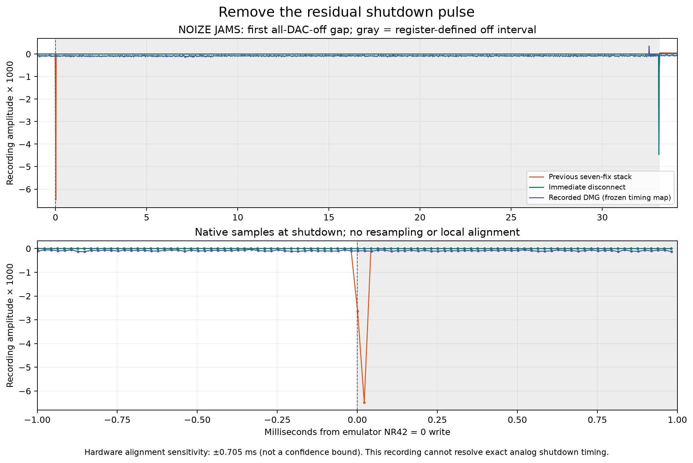

# Residual all-DAC-off shutdown pulse

The seven-fix stack removed the long high-pass decay in NOIZE JAMS but still
emitted a short negative pulse when the final enabled DAC was disabled. The
mixer's connection condition also counted the artificial DAC discharge value,
so the coupling capacitor stayed connected while that value faded. The
correction disconnects according to the real DAC-enable bits immediately while
retaining the existing discharge calculation for mixed-DAC operation.

Core commit: `79fb345c` (`APU: disconnect the DMG mixer without waiting for DAC discharge`),
following the seven-fix publication head `8182d8ed`.

## Regression

The callback regression uses register writes, ordinary cycle advancement and
real 48 kHz audio callbacks. It fails 32 assertions against `8182d8ed`: each
final-DAC shutdown emits two nonzero samples and updates the coupling capacitor.
With the correction it passes for all four channels: the next output is zero
and capacitor state is held immediately. The eight CGB and DMG
other-enabled/inactive/unrouted-DAC control traces, including capacitor values,
are byte-identical before and after. The existing mixer regression also passes.

The minimal ROM check now allows only completion of the traced 12-T-cycle LDH
instruction, with no additional DAC-discharge grace period. It changes from
612 nonzero stereo values to zero across all 336 complete off intervals.

The enabled-DAC control now keeps the boot ROM's CH1 DAC enabled continuously
and expires its channel through the length counter. Its entire before/after
WAVs are byte-identical. The previous control reset NR52 during startup,
briefly disabling every DAC and thus exercising the changed behavior itself;
its initial filter history differed through 1.452792 seconds. Those initial
results are retained in the local investigation under `artifacts/dac-edge/{before,after}/probe-*`; the
verification reports are copied here as `results/dac-edge/startup-reset-*-verification.json`.
They are not hidden by dropping a startup window. The revised full captures and
verification reports are published under `results/dac-edge/{before,after}-*`.

```sh
sameboy_checkout=/absolute/path/to/SameBoy
bash benchmark/run-dac-edge-test.sh "$sameboy_checkout"
mkdir -p build/dac-edge
python benchmark/verify-dac-off.py --prefix results/dac-edge/after \
  --control-reference results/dac-edge/before-dac-control.wav \
  --out build/dac-edge/after-verification.json
```

Use `--prefix results/dac-edge/before` to reproduce the expected 612-value
failure. `--silence-only` remains available but skips the independent control
comparison. The README gives fresh-render commands using a separately built
capture executable and explicit SameBoy checkout. The callback observation
interval is the existing fade duration, `ceil(48000 / 20000) = 3` samples;
setup settling derives from the synthesis kernel and DAC attack rate, not an
allowance on the tested shutdown edge.

`results/dac-edge/run.json` records the built source, binary, input and result
hashes and the original-song capture command. The source/ROM regression is
emulator-side coverage; no new physical recording was made.

## Physical recording comparison

The local analysis script `oracle-analysis/dac_edge_probe.py` compares the previous seven-fix capture with
the immediate-disconnect candidate and the original stock-headphone DMG
recording. It uses the same 32 trace-defined gaps, 15.186-second passage, left
channel, affine clock map, scalar gain, and 1 ms native-sample envelope bins as
the original investigation. Neither signal is locally realigned, equalized,
normalized, or resampled. The source WAVs are preserved and their hashes are
checked. The 3,695 APU writes are identical in both emulator renders and the
original baseline.

| Measurement | Previous seven-fix stack | Immediate disconnect |
|---|---:|---:|
| Shutdown samples in the first existing envelope bin after each off write | 40 total; 1–2 per gap | 0 across all 32 gaps |
| Full-gap pooled RMS, recording full scale | 0.000100900 | 0.000034813 |
| Full-gap 1 ms envelope normalized RMSE against DMG | 1.544673 | 1.083846 |

The measured full-gap energy falls 88.10% (9.24 dB). The hardware pooled RMS is
0.000075793, including its offset and noise. Exact zero is not expected to match
that recording's noise floor. The full-gap envelope error also falls under both
previously established timing sensitivity shifts of ±0.705412 ms.

In the first gap, the previous render's two shutdown samples peak at 0.006487
after the frozen gain. The recorded hardware's first 1 ms bin peaks at 0.000126;
the previously established timing-sensitivity bins peak at 0.000115–0.000126.
The candidate has no shutdown pulse in that bin. This supports removing the
large synthesized pulse, but does **not** establish the exact analog edge shape:
the recording is 48 kHz and the timing sensitivity is much larger than two
samples. The sensitivity shifts are measured onset discrepancies, not a bound
on the unknown register timing. Capture filtering and LFSR phase also remain
limitations.

The full gaps are **not all zero** under a timestamp-only PCM slicing rule.
There are 28 retained nonzero samples near the far end of those windows, at the
DAC **re-enable** boundary. They occur within one sample period of that boundary
and are retained in the full-gap energy measurement. The removed samples are
the separate pulse at the beginning of every off interval; the candidate does
not remove the re-enable spike.

## Re-enable check

The comparison reuses both existing `dac_on_probe.py` window definitions across
31 subsequent enables (62 windows). The final off window ends at the original
analysis cutoff before its re-enable. No new timing window was fitted.

| 1 ms envelope normalized RMSE | Previous stack | Immediate disconnect |
|---|---:|---:|
| First trigger to next trigger | 0.363110 | 0.363323 |
| DAC enable through first changed NR43 after trigger | 0.322859 | 0.322937 |

Re-enable envelope error is slightly worse in these two measurements, while
their RMS level error and correlation improve slightly. Both sensitivity shifts
retain the small envelope-error increase. The earlier capacitor hold changes
its later output; this is not evidence of a re-enable accuracy improvement or a
bit-identical re-enable waveform. The measured difference is far smaller than
the timing sensitivity, but that observation is not an acceptance threshold.

## Inspect the preserved song measurements

`results/dac-edge/analysis.json` contains all gap and re-enable metrics and
source hashes; `first-edge.png` shows the entire first gap and its shutdown
samples; `first-edge-native.csv` contains the plotted native samples.



These are preserved measurements made using the full local original recording
and independently obtained LSDj inputs. The local analysis script and full
music/ROM/save inputs are not included, so this package does not offer a
self-contained rerender of the song analysis. The existing unprocessed
15.186-second left-channel PCM24 excerpt in `hardware/lsdj-dac-excerpt.wav`
supports inspecting the physical passage; its provenance is unchanged.
Historical paths in the reports identify local originals, not installation
requirements. Generated ROM regression fixtures were not recorded on hardware.

The previous capture SHA256 is
`aaa111454c7f49e826883d77423cd8e49f8c031a90eee03561bb18801ea6b09d`;
the candidate is
`ff4aef9818a99491d9dc72b70eb1251c69a78e2a8821729b2f438a9c9e270d10`.
The immutable original hardware WAV SHA256 is
`7ed45a1c3a2859b6853381e859a7085070334dea86f8269f5f1f4bc1bdffdd34`.
