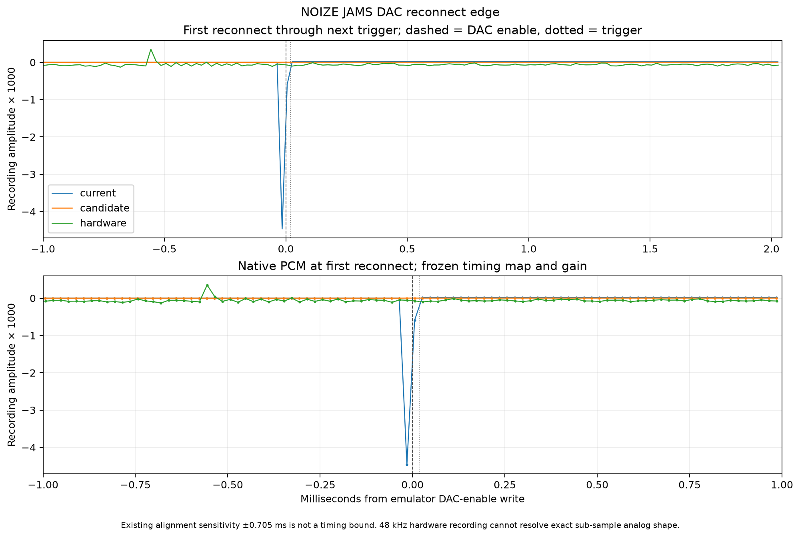

# DMG DAC reconnect pulse

This report preserves measurements from `f51cb47b`. The subsequent
[DAC timing correction](DAC-TIMING.md) aligns DAC controls with the synthesis
pipeline. Current callback sources account for that delay; the exact earlier
test source is archived beside these historical results as `historical-test.c`.
Zero-latency output expectations below describe the historical head only.

Core commit `f51cb47b133b2291887463b1f74eb7b7298bb1ae` follows the immediate-disconnect fix
`79fb345c2735e37e8a94b95030986a81d1a557af`. While every DAC was disabled, the
mixer correctly held its coupling-capacitor charge, but each DAC's attack state
continued down to zero. Re-enabling a DAC ramped its level up against that held
charge, synthesizing a negative pulse. The correction reconnects the newly
enabled DAC at full level when the mixer was disconnected. It preserves the
capacitor and retains the existing attack behavior when another DAC is enabled.
The change is restricted to the existing DMG-B output-disconnection model.

## Original NOIZE JAMS recording

All 31 re-enables in the original 15.186-second passage produce a negative peak
of **−0.004465689** in the previous core, after the frozen recording gain. The
candidate removes every such pulse; the first 1 ms of each enable peaks at
**0.00000193404**, one emulator PCM16 unit after gain. The first hardware window
peaks at 0.000100851. The native window includes the PCM bin straddling the
register write, rather than incorrectly omitting a reconnect sample timestamped
just before the boundary.

For 30 events, the previous pulse is 8.11–78.04 times larger than even the
expanded hardware window: the original 1 ms interval plus the previously
measured ±0.705412 ms onset discrepancy. The remaining NR42=$F8 attack contains
large genuine hardware audio and is not treated as evidence of silence.
The discrepancy is sensitivity analysis, not a confidence bound on hardware
register timing. Gain, affine timing, channel selection and window definitions
remain those in [`benchmark/baseline.json`](benchmark/baseline.json); there is no local fitting,
resampling, or EQ in the native-sample analysis.



The existing broader onset metrics are mixed and do not demonstrate a general
improvement to every onset:

| Existing 1 ms envelope normalized RMSE | Previous core | Candidate |
|---|---:|---:|
| First trigger through next trigger | 0.363322571 | 0.364286157 |
| Enable through first changed NR43 after trigger | 0.322937117 | 0.322932667 |

The first metric also worsens at both existing sensitivity shifts. The second
improves at the negative shift and worsens at the positive shift. Canonical
envelope correlations improve. NOIZE JAMS interleaves DAC enable, pitch setup,
trigger, routing and subsequent envelope writes; removing its artificial edge
does not establish the accuracy of all those other transitions.

## Independent recorded channel controls

The finalized `artifacts/hardware/torture-pula2a6h/capture.wav` already contains
all eight cases 177–184 from the immutable `render-h1xqcgiz` manifest: each
channel's digital zero, DAC disable and re-enable, paired with another inactive,
unrouted DAC remaining enabled. Complete-suite before/after renders preserve
the recorded stimulus history, seed 1 and ROM-defined completion. The before
render uses the preserved 79fb345c executable, without rebuilding current code.
Before/after APU writes, suite markers and final screen are byte-identical.
All original suite markers and the selected case writes also match the older
hardware reference; earlier digital fixes change some other readback packets.

All four all-off cases show the narrow negative reconnect pulse in the previous
core and its removal in the candidate. No comparable negative pulse is visible
in their hardware recordings. Positive offsets and subsequent waveform/phase
differences remain visible in the [eight-case figure](results/dac-reconnect/torture/reconnect-controls.png).

Complete control cases 178 (CH1), 182 (CH3) and 184 (CH4) remain byte-identical.
CH2 control case 180 changes 934 of 3004 frames, with a maximum change of 2640
PCM16 units. Its changes run from initial setup at 557.4360625 s through
557.4829167 s, before the reconnect at 557.482988358 s. Its reconnect and the
rest of the case remain identical; its earlier all-DAC-off startup and capacitor
history do not. This difference is retained, not removed from the comparison.

The existing packet calibration is reused unchanged. Its 10.8 µs RMS timing
residual does not make register writes sample-aligned to physical edges:
SameBoy's 64-tap band-limited kernel has its midpoint at 32 samples, or 0.6667 ms
at 48 kHz, while mixer gating follows a different path. The plots retain these
timing differences. Native 48 kHz PCM and the unknown analog capture transfer
cannot establish the physical sub-sample edge shape or exact switching latency.

## Regression

`benchmark/run-dac-reconnect-test.sh` drives register writes and ordinary audio
callbacks on all four channels. It checks unchanged-source reconnection and
real voltage steps caused by changing NR50 or NR51 while disconnected, without
resetting the capacitor or suppressing real transients. The 36 cases fail 44
checks on 79fb345c and pass on this commit. All 24 CGB and other-enabled-DAC
control traces remain byte-identical. Existing shutdown and mixer regressions
also pass.

The complete original-suite candidate render decodes all 337 expected acoustic
packets with no missing or duplicate packets, correct order and a suite-end
packet. The eight selected control cases emit no RAM readbacks; this check is
not a new full-suite readback validation.

## Reproduction and provenance

The portable callback regression is included:

```sh
sameboy_checkout=/absolute/path/to/SameBoy
bash benchmark/run-dac-reconnect-test.sh "$sameboy_checkout"
```

It checks all four DACs with unchanged sources, NR50 changes while disconnected,
and NR51 changes while disconnected. The held capacitor and first reconnected
PCM sample are checked exactly, without an error tolerance. Genuine source
changes must produce nonzero reconnect output. Against the preserved 79fb345c
library it fails 44 checks; the candidate has zero failures. All 24 CGB and
other-enabled/inactive/unrouted-DAC control lines are byte-identical.
`results/dac-reconnect/reconnect-{before,after}.{stdout,stderr,json}` and
`reconnect-comparison.json` retain these results and input hashes. Existing
shutdown and mixer regressions also pass; see `results/dac-reconnect/validation/`.

`results/dac-reconnect/noize/` contains the native-sample analysis, plotted CSV,
and figure; `results/dac-reconnect/torture/` contains the eight-case analysis,
figures, full-frame variant differences and original render provenance.
`packet-and-controls.json` retains the actual candidate packet decode: all
337 expected packets are present, with seven additional invalid/partial search
candidates explicitly listed. The physical packet coverage is reused from the
already validated recording, not presented as a new hardware capture.

`results/dac-reconnect/mechanism/` contains the instrumented frontend, native
state trace and exact arithmetic explaining the first spike. Its manifests and
other original JSON reports are copied verbatim. Their historical paths and
hashes include inputs not redistributed here: original full WAVs, instrumented
binaries/static libraries, and LSDj program/save. They document provenance,
not a self-contained replay command. No new long WAV or program/save is included.
Original recordings are preserved; the existing hardware excerpt and complete
standalone-test FLACs remain available in this evidence package.

The original local audio-analysis commands remain in the source report
`benchmark/DAC-RECONNECT.md`. Re-running those exact comparisons requires those
independently obtained LSDj inputs and original container paths. The native CSV,
measured summaries and callback regression can be inspected independently.

| Artifact under `artifacts/dac-on-edge/` | SHA256 |
|---|---|
| `candidate/capture.wav` | `e04458e12ac432376f2556c5a2668b8c7cb4be8396ed60b7195416911aed7b00` |
| `torture-before/audio.wav` | `4d19ac3574a74d83b55cf2493c3adab41ca6a94312e6851e575d1fd2b4064948` |
| `torture-after/audio.wav` | `bdff9c0fceb184723455de9bbc9ebb47a2dedb23e9b7aca41e655ae60966a696` |
| `comparison/analysis.json` | `c63a11037682c3428115328e05736a166a834377b41fe0431bd2d635c2000ba9` |
| `torture-comparison/analysis.json` | `b2f44a309eed2869def5d93a030f64660467100807a5ade975c93de59550412f` |
