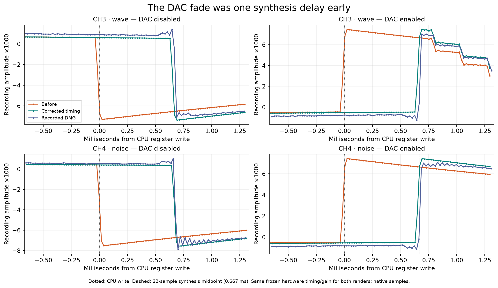

# Keep DMG DAC envelopes on the synthesis timeline

Core commit `2d6ea110275b17de06d9d1c1a621adf625973cac` follows `f51cb47b`. Band-limited channel
samples pass through a 64-tap synthesis kernel, but DAC attack/discharge gains
and DAC-enable state previously followed the current CPU state. They
therefore affected an older audio sample. The correction queues those existing
gains and the enabled-DAC mask by the kernel's 32-sample midpoint on the filtered
DMG path. At 48 kHz that is 0.6667 ms; it is derived from the synthesizer, not
fitted to this recording. The candidate retains the existing fade curve and
coupling-capacitor calculation.

## Recorded discriminator

The unmodified recording is
`artifacts/hardware/torture-pula2a6h/capture.wav`, SHA256
`c998f8af6ed5389fdbc12127d68da749bfe7ba341f67afda141fe8e31cc73960`.
It is stock DMG headphone output into Scarlett inputs 3–4, 48 kHz PCM24. Left
channel is used; the right has inverted polarity. The physical board/CPU
revision is unconfirmed; DMG-B identifies the emulated model.

Cases 178/180/182/184 play CH1/2/3/4 respectively, replace the waveform with
digital zero for one source-defined frame-sequencer cycle, disable its DAC for
another cycle, then re-enable and trigger. A separate inactive, unrouted DAC
remains enabled throughout these transitions. Thus the mixer stays connected
and disabling the routed DAC produces a legitimate voltage step. The paired
177/179/181/183 cases have every DAC disabled instead. Exact writes, values and
times for all eight cases are in
`artifacts/dac-connected/hardware/analysis.json`.

Three explanations were distinguished:

1. **Incorrect recording alignment.** The same-case digital-zero edges already
   agree between emulator and hardware within −0.225 to +1.209 native samples.
   Nearby packet markers have frozen-map residuals of +0.171 to +0.605 samples.
   The 62 edges in all 31 complete steady 256 Hz calibration periods agree
   within −0.567 to +0.614 samples, RMS 0.450 samples. The first source period
   includes startup and is retained separately. A global recording shift would
   misalign these independent controls.
2. **Wrong amplitude or fade curve.** The hardware contains real negative
   DAC-off steps on all four channels, and positive reconnect steps on CH3/CH4.
   Removing those transients would be wrong. A timing-only candidate retains
   the existing fade and gain and substantially improves these edges. This
   does not establish an exact physical fade shape: the analog capture rings,
   and 48 kHz sampling cannot resolve the sub-sample curve.
3. **DAC gains bypassing synthesis delay.** The previous DAC-off edges arrive
   31.73–33.02 native samples before the hardware edges under the same frozen
   map. Delaying only the gain/enable states by the kernel midpoint removes
   that discrepancy while retaining the aligned digital-zero transitions.

Native edge times are midpoints of the two samples containing the strongest
signed difference inside the kernel-derived observation window. No per-edge
alignment, per-variant gain, EQ, or waveform filtering is fitted.

| Mixed-DAC transition | Hardware minus previous, samples | Hardware minus delayed, samples |
|---|---:|---:|
| CH1 DAC off | 32.165 | 0.165 |
| CH2 DAC off | 33.021 | 1.021 |
| CH3 DAC off | 32.876 | 0.876 |
| CH4 DAC off | 31.731 | −0.269 |
| CH3 DAC on | 32.831 | 0.831 |
| CH4 DAC on | 32.687 | 0.687 |



The [complete transition grid](results/dac-timing/hardware/edge-controls.png)
also retains the pulse-channel reconnect discrepancy and the independent
digital-zero controls.

The packet calibration aligns synthesized audio, including its filtering delay;
the table is not a measurement of a 0.667 ms delay inside the physical DAC.
Its discriminator is the difference between digital and DAC-envelope paths
under that one independently established mapping.

## Complete-case comparison and remaining pulse behavior

The original clock ratio `1.0000585963100947`, offset `94.04181316194428` seconds
and gain `0.06392767566127538` remain unchanged. Before is the actual
`f51cb47b` full render in `artifacts/dac-on-edge/torture-after/`, not the older
historical baseline embedded in the comparator's output.

| Case | Correlation before → after | Waveform RMSE before → after |
|---|---:|---:|
| 177, CH1 all-off | 0.969148 → 0.971352 | 0.023041 → 0.022200 |
| 178, CH1 other-DAC control | 0.949671 → 0.969898 | 0.029846 → 0.022982 |
| 179, CH2 all-off | 0.968514 → 0.971516 | 0.023264 → 0.022113 |
| 180, CH2 other-DAC control | 0.949196 → 0.969517 | 0.029954 → 0.023094 |
| 181, CH3 all-off | 0.990251 → 0.995623 | 0.008998 → 0.006086 |
| 182, CH3 other-DAC control | 0.950519 → 0.994498 | 0.020616 → 0.006863 |
| 183, CH4 all-off | 0.987439 → 0.995578 | 0.007425 → 0.004625 |
| 184, CH4 other-DAC control | 0.937771 → 0.995708 | 0.020148 → 0.005496 |

The subsequent complete 189-case comparison decreases waveform RMSE in every
case. The sample-weighted pooled RMSE is 0.0083014034 before and 0.0081145269
after. Both renders decode 337/337 packets with zero hardware readback
differences. These are descriptive results against the same existing recording
and frozen calibration, not new hardware observations or proof that every
remaining waveform is accurate. Complete metrics and deltas are saved in
`artifacts/dac-connected/{before-all-cases,final-all-cases,full-case-deltas}.json`.

CH1/CH2 reconnects still differ: hardware first goes negative around the
corrected transition, then positive about half a millisecond later; the
emulator initially stays positive. These cases combine DAC enable with an
immediate trigger and retained pulse state. A delay correction does not fix
that sign/phase difference, and it is not hidden by choosing a later hardware
edge. The raw waveform plots retain both transitions. Static offsets, analog
ringing and fine slope differences also remain; the table is not a claim of
sample-exact hardware equivalence.

The existing NOIZE JAMS comparison is effectively unchanged by this timing
follow-up: envelope correlation is 0.871606777 before and 0.871606685 after;
raw waveform correlation is 0.528844417 before and 0.528844406 after. These tiny
changes are not a song-level correlation improvement. The evidence here is the
recorded channel-control transitions, distinct from the earlier reconnect-pulse
removal. Music results are retained in
`artifacts/dac-connected/noize/metrics.json`.

## Reproduce and provenance

```sh
sameboy_checkout=/absolute/path/to/SameBoy
make -C "$sameboy_checkout" CONF=release build/lib/libsameboy.a
bash benchmark/run-dac-timing-test.sh "$sameboy_checkout"
bash benchmark/run-dac-edge-test.sh "$sameboy_checkout"
bash benchmark/run-dac-reconnect-test.sh "$sameboy_checkout"
python results/dac-timing/hardware/figure.py
```

The callback tests and compact figure can be reproduced directly from this
package. `results/dac-timing/hardware/analyze.py` preserves the original full
analysis source; it requires the original working layout and WAV containers
named by its input hashes. It is not a portable command against this package.
The native `edge-controls-native.csv`, all edge observations, calibration-tone
controls and packet residuals are included without new fitting. The companion's
existing original-suite FLAC retains the full hardware PCM; long emulator WAVs,
LSDj program/save files, binaries and static libraries are not added here.

Published timing metrics, full-case deltas, callback logs and run provenance are
under `results/dac-timing/`; its `renders/` subdirectory retains each candidate's
original provenance and final manifest. `hardware/render-identity.json` verifies
the final enabled-mask render against both intermediate renders.
`mechanism/` contains the minimal register-write proof, native traces and
DC-offset review including the rejected intermediate candidate. Historical
absolute paths in these original reports identify the measured inputs.

The timing-only diagnostic render is `artifacts/dac-connected/delay-render/`.
The production render is `artifacts/dac-connected/final-mask-render/`; its WAV,
APU trace, suite markers and final screen are byte-identical to both the initial
diagnostic and intermediate `final-render/`. `hardware/render-identity.json`
records fresh hash verification of all four outputs for all three renders. The production
WAV SHA256 is
`d373863ea38544ea2a84ec5b3de0dca2f05b56f92067970b258117cff3b77195`.
All source variants have their own provenance. Native measurements were made
against the intermediate render; the report is pinned to the final enabled-mask
render by verified sample/trace identity, without recomputing or fitting metrics.
The preserved analysis source selects that final render and checks its identity.

Before-case scores are in `artifacts/dac-on-edge/packet-and-controls.json`;
after scores are in `artifacts/dac-connected/delay-metrics.json`. That selected
comparison decoded all 337/337 original-suite packets with complete coverage
and unchanged CPU marker timing; the later complete-case reports above also
compare every readback. Complete-suite rendering preserves the exact original
ROM history rather than replacing it with isolated cases. Original recordings
remain unchanged.

## Callback and DC-offset controls

The focused callback regression reports 16 failures before and none after; all
40 CGB output controls remain exact. Updated shutdown and reconnect regressions
account for the synthesis delay and pass. The older standalone gap checker is
historical evidence for `79fb345c`: its first-sample expectation assumes zero
pipeline latency and must not be used unchanged on this head.

Review also found that queuing only a connected boolean left DC-offset-removal
mode using the live DAC mask. That intermediate candidate introduced an
anticipatory +441 PCM16 sample before the delayed voltage step. The final
enabled-mask queue keeps all 32 preceding samples and capacitor state exactly
at the settled +3 PCM16 value, then retains the legitimate negative step
(−1559, −3825, −4050 in the first three delayed samples). This is a deterministic
emulator mechanism check, not additional hardware measurement. Source, samples,
review chronology and hashes are retained under
`artifacts/dac-connected/mechanism/review-dc-mode.json`; the physical transition
analysis above uses accurate high-pass mode and is unchanged by this refinement.

## Throughput observation

One sequential before/after render of the same finite 563.645-second suite
took 19.5924 and 20.0009 seconds respectively (about 28 times real time). The
observed wall-time difference is about 2.1%; one pair does not establish a
regression or speedup statistically. Both temporary runs reproduced the
validated audio/trace/marker/screen hashes. The original commands, executable
hashes and CPU times are in `results/dac-timing/throughput.json`;
`measure-throughput.py` retains the local measurement source.
